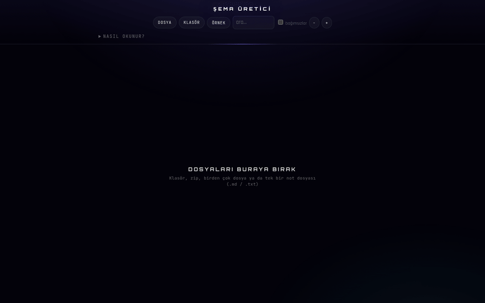
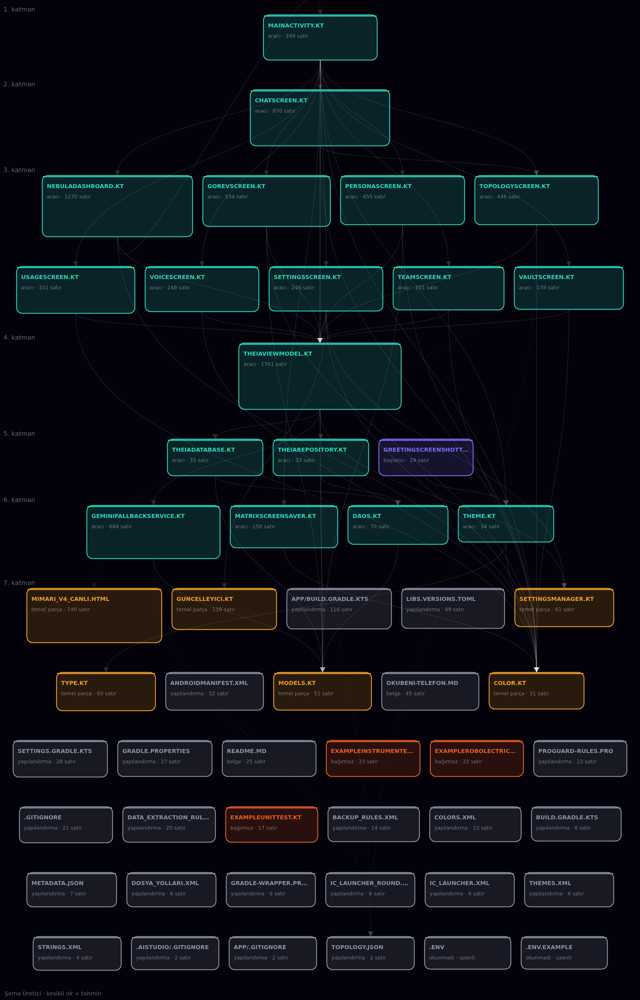

# SCHEMAMME · Şema Üretici

**Bir klasörü bırakıyorsun, kodun haritasını alıyorsun.** Yerel çalışır, dosyalar hiçbir yere gönderilmez.



Ekranda olan biten — gerçek uygulama, gerçek bir Kotlin projesi (Theia-Spring, 53 dosya):


---

## Neden var

Bir projeye dışarıdan bakınca ilk sorular şunlar oluyor: *hangi dosya neyi çağırıyor, hangisine dokunmak riskli, hangisi kimse tarafından kullanılmıyor?* Bu soruların cevabı genelde kafada tutuluyor ve yanlış hatırlanıyor. Şema Üretici bunu **ölçüyor**:

- Her dosya bir **kutu**; kutu **rengi** dosyanın rolünü, kutu **hacmi** satır sayısını gösterir.
- Dosyalar arası **bağ** iki sınıfa ayrılır: `kesin` (import / tanım yolu) ve `tahmin` (yalnız dosya adı benzerliği). Tahmin bağları **kesikli** çizilir.
- Katmanlar çağrı zincirinden hesaplanır: en üstte giriş noktaları, en altta ortak temel parçalar.
- Bir kutuya tıklayınca **panel** açılır: rolü, riski, çağırdıkları, onu çağıranlar, içindeki fonksiyon/sınıflar **satır numarasıyla**, ve modele verilecek hazır **görev tarifi**.

## Roller

| Rol | Ne demek | Risk |
|---|---|---|
| **başlatıcı** | Kimse onu çağırmıyor, o başkalarını çağırıyor (veya manifestte bildirilen giriş) | orta |
| **aracı** | Hem çağrılıyor hem çağırıyor — zincirin orta halkası | bağ sayısına göre |
| **temel parça** | Kimseyi çağırmıyor ama herkes onu kullanıyor (veri, tema, ortak yardımcı) | 3+ çağıran = yüksek |
| **bağımsız** | Hiçbir bağı yok — tek başına araç ya da eski dosya olabilir | düşük |
| **yapılandırma** | Derleme/bağımlılık/ayar tanımı (`kts`, `gradle`, `xml`, `properties`…). Kod bağı kurmaz, **"kullanılmıyor" hükmü verilmez** | orta |
| **okunmadı** | Uzantı okunmuyor · 4 MB üzeri · ikili içerik. Rol ve bağ **hesaplanmaz** | ölçülmedi |

Bu ayrım keyfi değil: **veri yokluğu hüküm değildir.** Okunamayan bir dosya "bağımsız" diye yazılsaydı, haritayı okuyan model onu silinebilir sanırdı.

## Çıktılar

| Düğme | Ne üretir | Ne işe yarar |
|---|---|---|
| 📘 **Harita (MD)** | `SEMA-HARITASI.md` | Modele verilecek belge: özet, katmanlar, sembol dizini (ad → dosya:satır), dosya kartları |
| 💾 **JSON** | `sema-graph.json` (şema sürüm 2) | Başka araçlar için: `dosya[]` (yol, satır, rol, risk, katman, sembol) + `kenar[]` (a, b, tip) |
| 🖼 **PNG** | `proje-haritasi.png` | Haritanın resmi — bağımlılık yok, harici kütüphane yok, canvas ile çizilir |
| 🧠 **Modele** | pano | Katman listesi + roller, tek yapıştırmada |

`SEMA-HARITASI.md` özet bölümü beş sınıfı ayrı sayar: giriş noktaları · riskli dosyalar · bağımsızlar · yapılandırma · okunmayanlar.

## Girdi biçimleri

- **Klasör** — sürükle-bırak ya da *Klasör* düğmesi (özyinelemeli okuma, `node_modules` / `.git` / `build` atlanır)
- **Dosyalar** — çoklu seçim veya sürükleme
- **Zip** — arşiv içinden harita (zip okuyucu **yereldir**, internet gerekmez)
- **Tek not dosyası** (`.md` / `.txt`) — dosya değil **başlık** haritası çıkar: üst başlık → alt başlık

Atlananlar: `node_modules` · `.git` · `__pycache__` · `.venv` · `build` · `.gradle` · `.idea` · `gradlew`/`mvnw` · resim/ses/video/apk/jar/zip.

## Ölçülen sonuç (16.11.2026)

Theia-Spring (Android/Kotlin) klasörü:

```
53 kutu · 59 bağ · 7 katman · çakışan kutu çifti 0
roller: yapılandırma 21 · aracı 18 · temel parça 6 · bağımsız 3 · belge 2 · okunmadı 2 · başlatıcı 1
en çok çağrılan: Color.kt (13) · TheiaViewModel.kt (11) · Models.kt (7)
giriş noktası: MainActivity.kt (manifestte bildirilen)
çıktılar: SEMA-HARITASI.md 74 KB · sema-graph.json 25 KB · proje-haritasi.png 2240×3498
```



## Çalıştırma

```bash
./baslat.sh                     # Electron varsa kendi penceresinde, yoksa tarayıcıda
xdg-open sema-uretici.html      # tek dosya, sunucu gerekmez
```

Gereken: bir Chromium tabanlı tarayıcı (Chrome/Chromium/Electron). Electron isteğe bağlı — yoksa tarayıcıda açılır. **Sunucu yok, kurulum yok, hesap yok.**

Masaüstü kısayolu:

```ini
[Desktop Entry]
Name=Şema Üretici
Exec=/tam/yol/baslat.sh
Icon=/tam/yol/icon.png
Terminal=false
```

## Nasıl çalışıyor (kısa)

1. **Okuma** — her dosya metin olarak okunur; okunmayan üç durum ayrı etiketlenir (uzantı / 4 MB / ikili bayt).
2. **Rol ve bağ** — Python/JS `import` ve `from` satırları, Kotlin `import` + proje paketi eşleşmesi, `class/object/fun` tanımları; ek olarak dosya adı benzerliği (`tahmin`).
3. **Katman** — kenar grafiğinde en uzun yol; döngü varsa kırılır.
4. **Yerleşim** — katman başına satır, kutu genişliği ada göre, çakışma yok.
5. **Kalıcılık** — son harita `localStorage`'a yazılır; sayfa açılınca geri gelir (kota dolarsa görünür uyarı verir, sessizce kaybolmaz).

## Bilinen sınırlar

- Bağlar **tahmindir**: dinamik çağrılar (`getattr`, reflection, string ile yükleme) görülmez.
- Uzantı listesi sabittir; listede olmayan uzantı okunmaz — ama "ölçülmedi" diye etiketlenir, hüküm verilmez.
- 4 MB üzeri dosyanın içeriği okunmaz (tarayıcı belleği); haritada görünür, bağı hesaplanmaz.
- Yazı tipleri Google Fonts'tan gelir; internet yoksa yedek fontla çizilir (işlev bozulmaz).
- Çok büyük projelerde (20.000+ dosya) süre uzar; sınır `docs` klasöründeki nota göre elle artırılır.

## Depo yapısı

```
sema-uretici.html   ← uygulamanın tamamı (tek dosya, ~60 KB)
main.js             ← Electron kabuğu (pencere açar, dış bağlantıları tarayıcıya devreder)
baslat.sh           ← Electron varsa onu, yoksa tarayıcıyı açar
jszip.min.js        ← zip okuyucu, yerel (JSZip 3.10.1, MIT)
icon.png            ← simge
docs/               ← akis.gif (akış animasyonu) · uygulama.gif (gerçek uygulama) · harita.png · akis.svg · kareler/
```

## Lisans

MIT. `jszip.min.js` için: JSZip 3.10.1, MIT, © Stuart Knightley ve katkıda bulunanlar.
